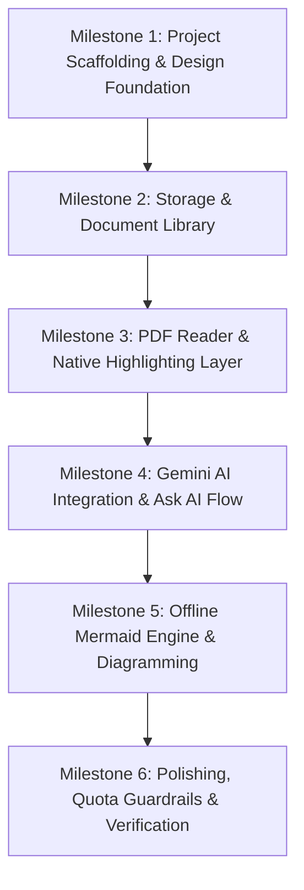

# Nota — Comprehensive Agent Project Context & Milestones

**Document Version:** 1.0  
**Target:** Antigravity AI Agent & Developer Pair  
**Platform:** Flutter (Android-first)  
**Primary Reference Files:**
- `context/nota_v1_prd_v1.1.md` (Product Requirements Document)
- `context/Nota - UI Design.pdf` (Visual specifications)

---

## 1. Product Vision & Core Concept

**Nota** is a personal, focused study companion designed to make studying from dense academic PDFs (textbooks, lecture notes, research papers) an active, generative process.

### The Problem
Traditional PDF readers offer passive highlighting—colored text on a page with zero cognitive reinforcement. Chatbots tacked onto document readers often float disconnected from the source passage and produce walls of text without visual structure.

### The Solution: Generative Highlighting & Chained AI
1. **Highlighting as an Action Trigger:** When a student highlights a passage, Nota displays a contextual floating tooltip: **Ask AI** or **Generate Diagram**.
2. **Grounded Inquiries:** "Ask AI" feeds the highlighted excerpt directly as grounded context, supporting two pedagogical modes: **Explain** (direct clarity) or **Hint first** (Socratic guidance).
3. **Automatic Diagramming:** "Generate Diagram" classifies the structural shape of the excerpt (`PROCESS`, `HIERARCHY`, `COMPARISON`, `RELATIONSHIP`, or `NONE`) and returns Mermaid syntax or a calm refusal state.
4. **Chained Flow:** An AI answer can itself be converted into a diagram via a secondary "Generate Diagram" button, passing both the source highlight and the AI's explanation as unified context.
5. **Segmented View:** Answer text and the visual diagram live together under a segmented tab toggle, allowing friction-free switching between prose and visual hierarchy.

---

## 2. Technical Stack & Key Decisions

| Layer | Selected Technology | Critical Implementation Directives |
|---|---|---|
| **Framework** | Flutter (Dart SDK `^3.10.0`) | Android-first responsiveness; edge-to-edge support; safe-area aware. |
| **State Management** | **Cubit** (light state) + **Bloc** (heavy state) | Follow the strict dual-pattern described in §3. |
| **PDF Rendering** | **`pdfrx`** (PDFium-based) | MIT-licensed (no Syncfusion commercial licensing traps). Native text selection with custom highlight overlay layer. |
| **PDF Page Tinting** | `ColorFiltered` (`BlendMode.multiply`) | **Crucial:** PDF pages render with their own white background. Wrap page rendering with a `BlendMode.multiply` filter tinted to the Paper background (`#EAE3D3`) so the document and the app chrome blend seamlessly. |
| **Local Storage** | **Hive** (`hive`, `hive_flutter`) | Fast, lightweight NoSQL key-value store for document metadata, highlight coordinates/text, user settings, and daily API usage counters. |
| **Diagram Engine** | **Offline bundled `mermaid.js` + WebView** (`webview_flutter`) | Must be fully bundled locally in app assets (no CDN dependency). Rendered in a borderless/seamless WebView with transparent background matching `#EAE3D3`. |
| **AI Integration** | **Google Gemini API** (`2.5 Flash-Lite`) | Single-call classify-then-generate prompt. Built around Gemini Free Tier quotas (15 RPM / 1,000 RPD). Stored API key on device. |
| **Iconography** | **`phosphor_flutter`** | Uniform, elegant outline iconography matching the minimalist design system. |
| **Typography** | Inter, JetBrains Mono, Newsreader (SIL OFL) | All bundled locally in `assets/fonts/` (zero runtime network downloads). Inter for UI, JetBrains Mono for status & monospace values, Newsreader for PDF quotes. |
| **File Handling** | `file_picker`, `path_provider` | Copying selected PDFs to local app documents directory; handling moved or missing files gracefully. |

---

## 3. State Management Protocol: Cubit vs. Bloc

Whenever state management code is written, you must **explicitly and clearly document how the state transitions work and why that specific tool was chosen**.

```
┌────────────────────────────────────────────────────────┐
│                   STATE SELECTION                      │
├───────────────────────────┬────────────────────────────┤
│       CUBIT (Light)       │        BLOC (Heavy)        │
├───────────────────────────┼────────────────────────────┤
│ • UI toggles & tabs       │ • PDF reader lifecycle     │
│ • Local input state       │ • Selection & highlights   │
│ • Settings & preferences  │ • AI Ask & Diagram flow    │
│ • Simple ephemeral flags  │ • Library batch operations │
│ • Synchronous transforms  │ • Quota & rate-limiting    │
└───────────────────────────┴────────────────────────────┘
```

### 3.1 Cubit (Light State Changes)
Use **Cubit** for simple, predictable state transitions where the overhead of event classes is unnecessary:
- **`SegmentedTabCubit`:** Switching between Answer and Diagram views.
- **`AnswerStyleCubit`:** Toggling between "Explain" and "Hint first".
- **`DiagramZoomCubit`:** Zoom in, zoom out, reset to fit.
- **`SettingsCubit`:** Managing user preferences (Gemini API key visibility/updates, storage stats).

*Documentation requirement:* Include a concise comment explaining:
1. The triggering action/method.
2. The emitted state and its direct UI consequence.

### 3.2 Bloc (Heavy State Changes)
Use **Bloc** with explicit `Event` and `State` hierarchies for complex workflows involving asynchronous operations, side-effects, cancellation, debouncing, or multi-step pipelines:
- **`LibraryBloc`:** Document import, loading list, multi-select mode, bulk deletion with undo timer, and handling missing/moved files.
- **`PdfViewerBloc`:** Document loading, page index tracking, selection detection, coordinate mapping for highlights, and highlight persistence.
- **`AiInteractionBloc`:** 
  - Debouncing incoming requests to protect API quota.
  - Calling Gemini Flash-Lite with single-call classify-then-generate prompts.
  - Streaming/handling responses, detecting refusal states (`NONE`), extracting Mermaid blocks, and setting the `inferred` flag.
  - Chaining context (Highlight Excerpt + AI Answer $\rightarrow$ Diagram Prompt).
  - Tracking daily request limits and surfacing limit warnings.

*Documentation requirement:* Every Bloc implementation must include an architectural header detailing:
1. Supported Events and their triggers.
2. State sequence (Initial $\rightarrow$ Loading/In-Progress $\rightarrow$ Success / Refusal / Failure).
3. Failure recovery and error handling strategy.

---

## 4. Design System & Aesthetics

Nota adheres to a **flat Apple-style minimalist aesthetic** built strictly with two complementary tones.

### 4.1 Color Palette
Strict two-tone paper-and-ink palette. No gradients, shadows, or blurs. Material 3 `surfaceTint` and elevation overlays must be disabled (`elevation: 0`, `surfaceTintColor: Colors.transparent`).

```dart
// Exact Design System Color Tokens
const ink = Color(0xFF17120D);
const paper = Color(0xFFEAE3D3);
const muted = Color(0xB317120D);      // 70% text
const hairline = Color(0x3817120D);   // 22% dividers
const cardEdge = Color(0x4717120D);   // 28% borders
const rowFill = Color(0x1417120D);    // 8% selected row
const hlFill = Color(0x2917120D);     // 16% saved highlight
const scrim = Color(0x6117120D);      // 38% sheet backdrop
```

- **Strictly Disallowed:**
  - No shadows (`BoxShadow` with blur).
  - No gradients.
  - No `BackdropFilter` or frosted glass blurs.
  - No accent colors outside the defined ink opacities on paper.

### 4.2 PDF Page Multiply Tinting
When rendering PDF pages in `pdfrx`:
```dart
ColorFiltered(
  colorFilter: const ColorFilter.mode(
    Color(0xFFEAE3D3), // Paper color
    BlendMode.multiply,
  ),
  child: PdfViewer.file(...),
)
```
This converts the harsh default white PDF page background into the exact warm Paper tone of the app without washing out black text or colored figures.

### 4.3 Typography Hierarchy & Offline Font Bundling
All three font families are open-source (SIL Open Font License - OFL) and **must be bundled locally in `assets/fonts/`**. Runtime network downloads (such as runtime Google Fonts fetching) are strictly prohibited to ensure 100% offline functionality.

- **UI & Controls:** **Inter** (`FontWeight.w400`, `w500`, `w600`) — bundled in `assets/fonts/inter/`.
- **Data, Labels & Monospace Values:** **JetBrains Mono** (`FontWeight.w400`, `w500`) — bundled in `assets/fonts/jetbrains_mono/`.
- **Quoted PDF Passages & Excerpts:** **Newsreader** (Serif, regular and italic) — bundled in `assets/fonts/newsreader/`.

Declared locally in `pubspec.yaml` under `flutter.fonts`.

### 4.4 Themed Progress Indicators & Loaders (No ASCII Elements)
All loading and progress states must be cleanly rendered using themed Flutter widgets matching the Ink on Paper aesthetic (no ASCII characters):
- **Linear Progress Bars:** Custom flat linear bar using `Ink (#17120D)` track on a muted paper outline, with square or subtle 2px rounded caps (e.g., daily API quota bar, document import progress).
- **Activity & Loading Spinners:** Minimalist, thin-stroke `CircularProgressIndicator` styled with `color: Color(0xFF17120D)` and stroke width of 1.5px – 2.0px.
- **Empty States:** Composed of clean `PhosphorIcons` (e.g., `filePdf`, `treeStructure`) paired with high-contrast Inter headings and muted JetBrains Mono subheadings.

### 4.5 Iconography (`phosphor_flutter`)
Standardized Phosphor icons to be used across the app:
- `PhosphorIcons.sparkle` (Ask AI, AI actions)
- `PhosphorIcons.treeStructure` (Generate Diagram, diagram tab)
- `PhosphorIcons.caretLeft` (Back navigation)
- `PhosphorIcons.plus` / `PhosphorIcons.minus` (Zoom in / out)
- `PhosphorIcons.check` (Confirmation, saved, settings save)
- `PhosphorIcons.warning` (Quota warning, error alert)
- `PhosphorIcons.x` (Close sheets, clear selection, dismiss)
- `PhosphorIcons.cornersIn` (Fit diagram to screen)
- `PhosphorIcons.arrowUp` (Submit question, prompt send)
- `PhosphorIcons.copy` (Copy answer or Mermaid code)
- `PhosphorIcons.info` (Context elaboration badge, info dialogs)
- `PhosphorIcons.dotsThree` (Overflow menu, document options)
- `PhosphorIcons.trash` (Delete document or highlight)
- `PhosphorIcons.slidersHorizontal` (Settings, answer style toggle)
- `PhosphorIcons.magnifyingGlass` (Search in library/document)
- `PhosphorIcons.filePdf` (PDF file placeholder / library item)

---

## 5. Offline Mermaid & Diagram Architecture

### 5.1 Why WebView + Mermaid.js? (Can we render directly in Flutter?)
**No pure Dart/Flutter engine exists for Mermaid.**  
Mermaid is not just a layout specification; it is a complex JavaScript engine coupled with:
1. **D3.js and Dagre** graph layout algorithms.
2. **DOM/SVG text measurement:** To calculate node widths, line wraps, and arrow paths, Mermaid dynamically creates DOM elements and calls browser layout APIs (like `getBBox()`).
3. Parsing engines for flowcharts, sequence diagrams, class graphs, and state diagrams.

In Flutter, any package attempting to parse Mermaid (like `mermaid_render` or `flutter_mermaid`) runs a WebView under the hood. While a headless JavaScript engine (like QuickJS) can execute JS, it lacks a browser DOM engine to calculate SVG geometry. 

Therefore, embedding an **offline, local asset-based WebView** is the industry-standard and most robust approach:
- It requires **zero internet access** (bundled locally via `assets/mermaid/`).
- It has **zero browser chrome** (transparent/paper background `#EAE3D3`, no URL bar, no scrollbars).
- To the user, it renders seamlessly as a native Flutter widget canvas with pinch-to-zoom and pan support.

### 5.2 Implementation Details
1. **Local Asset Bundling:**
   - Store `mermaid.min.js` directly in `assets/mermaid/mermaid.min.js`.
   - Store an HTML host template in `assets/mermaid/index.html`.
2. **WebView Host:**
   - Load local HTML with `webview_flutter` using local asset channels.
   - Run in offline sandbox with JavaScript enabled and no external network calls permitted.
3. **Rendering & Pan/Zoom:**
   - Pass Mermaid definition to the page via a JS bridge function: `renderDiagram(mermaidCode)`.
   - Configure Mermaid theme variables to match `#17120D` ink strokes and transparent/paper backgrounds.
   - Embed panzoom controls (or pinch-to-zoom gesture support) within the web view or via Flutter interactive viewers.
4. **Refusal & Error Resilience:**
   - If Gemini returns `NONE` or unparseable syntax, catch it gracefully before sending to the WebView.
   - Present the clean, user-friendly empty/refusal state rather than a broken web view or crash.

---

## 6. Project Milestones & Execution Roadmap



### Milestone 1: Foundation, Theme & Design System Setup (COMPLETED)
- [x] Configure `pubspec.yaml` with required dependencies: `flutter_bloc`, `pdfrx`, `hive`, `hive_flutter`, `webview_flutter`, `phosphor_flutter`, `file_picker`, `path_provider`, etc.
- [x] Establish design system constants with exact color tokens (`ink`, `paper`, `muted`, `hairline`, `cardEdge`, `rowFill`, `hlFill`, `scrim`) and zero-elevation theme config.
- [x] Bundle offline font files in `assets/fonts/` (Inter, JetBrains Mono, Newsreader) and register in `pubspec.yaml` (no runtime network downloads).
- [x] Set up asset directories for offline Mermaid (`assets/mermaid/`).
- [x] Build reusable UI primitives: Flat pill buttons, hairline dividers, paper cards, bottom sheet containers, themed flat linear progress bars, and thin-stroke ink spinners.

### Milestone 2: Hive Local Storage & Document Library
- [ ] Define Hive models & TypeAdapters: `DocumentModel`, `HighlightModel`, `UserSettingsModel`, `DailyUsageModel`.
- [ ] Implement `LibraryBloc` for document lifecycle:
  - Import PDF via `file_picker`, copy to local sandbox directory.
  - Populate library grid/list with thumbnail or icon (`PhosphorIcons.filePdf`), page count, and highlight count.
  - Multi-select mode with bulk delete and short-window Undo snackbar.
  - Missing or moved file state ("File moved or deleted" with "Locate file" or "Remove").
- [ ] Build Library UI with minimal empty state (Phosphor icon + typography) and populated state.

### Milestone 3: PDF Reader & Multiply Tinted Highlighting Layer
- [ ] Implement `PdfViewerPage` using `pdfrx`.
- [ ] Apply `ColorFiltered(BlendMode.multiply, Color(0xFFEAE3D3))` to match PDF pages to the paper chrome.
- [ ] Implement native text selection listener and custom persistent highlight overlay.
- [ ] Build floating selection tooltip: **Ask AI** and **Generate Diagram**.
- [ ] Persist highlight rects/text to Hive; restore highlights on document reload.
- [ ] Tapping a saved highlight opens the action menu: **Ask AI**, **Diagram**, **Remove highlight**.

### Milestone 4: Gemini AI Integration & "Ask AI" Flow
- [ ] Create `GeminiService` using Google Gemini 2.5 Flash-Lite.
- [ ] Securely store and retrieve user's Gemini API key in Hive.
- [ ] Implement `DailyUsageTracker` (debouncing rapid taps, counting daily requests against the 1,000 RPD cap, handling exhaustion mid-session).
- [ ] Implement `AiInteractionBloc` for the "Ask AI" flow:
  - Free-form question prompt grounded with the highlighted excerpt.
  - "Explain" vs "Hint first" (Socratic) answer style switch.
- [ ] Build the non-blocking Answer bottom sheet with quoted excerpt preview (Newsreader serif) and chained "Generate Diagram" button.

### Milestone 5: Offline Mermaid Diagram Generation & Interactive Viewer
- [ ] Set up offline bundled `mermaid.js` inside local assets and configure the WebView bridge.
- [ ] Implement the **classify-then-generate** Gemini prompt in `AiInteractionBloc`:
  - Classify structure (`PROCESS`, `HIERARCHY`, `COMPARISON`, `RELATIONSHIP`, `NONE`).
  - Flag `inferred: true` if inferred from broader context.
  - Defensive parsing to prevent syntax crashes.
- [ ] Support chained generation (Highlight Excerpt + AI Answer $\rightarrow$ Diagram context).
- [ ] Build Diagram View:
  - Segmented tab toggle (Answer $\leftrightarrow$ Diagram).
  - Pinch-to-zoom / pan canvas with zoom controls (`plus`, `minus`, `cornersIn`).
  - `[ ELABORATED FROM CONTEXT ]` badge display.
  - Friendly refusal card when no diagrammable structure exists.

### Milestone 6: Settings, Edge Cases & End-to-End Verification
- [ ] Implement Settings Screen:
  - Masked Gemini API key entry and verification.
  - Daily AI usage meter with themed linear progress indicator and numeric request count.
  - Default answer style preference (Explain vs Hint first).
  - Storage summary and "Clear all data" action.
- [ ] Edge cases stress-testing:
  - Handling multi-column or complex text selection.
  - App killed mid-generation (no stuck pending states).
  - API quota exhaustion display (clear warning, no infinite spinner).
- [ ] Full smoke test on Android device/emulator: Import $\rightarrow$ Read $\rightarrow$ Highlight $\rightarrow$ Ask AI $\rightarrow$ Chained Diagram $\rightarrow$ Verify offline Mermaid rendering.

---

## 7. Guidelines for Agent Execution

1. **State Transparency:** Before writing or updating any state management class, comment on whether it is a **Cubit** or **Bloc** and outline its state transitions.
2. **Design Integrity:** Do not introduce modern shadows, blur, or vibrant accent colors. Everything must stay true to **Ink on Paper**.
3. **Offline Reliability:** Never fetch `mermaid.js` over a CDN; rely strictly on local bundled assets.
4. **Defensive API Handling:** Protect the user's free tier quota. Debounce actions, prevent redundant requests, and handle API errors with informative messages.
